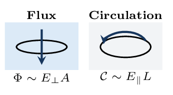
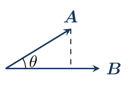
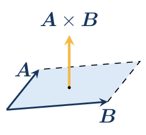

## Electromagnetic fields

### Why electromagnetism matters

Gravity governs the universe on large scales while electromagnetism governs the universe from everyday to atomic scales.
Electromagnetism  assembled the periodic table and provides us sunlight.  It is electromagnetism that we harness for our
modern lifestyles. And electromagnetism runs our muscles and nerves
and even our thoughts and emotions.

### Coulomb’s and Ampère’s laws

Both gravitational and electromagnetic forces follow inverse-square laws. But electromagnetism is $10^{40}\times$ stronger than gravity
and exhibits both **attraction** and **repulsion**.

Charge and mass are irreducible dimensions of nature.
Charge is **conserved** and **quantized**;
the proton and electron have charges $\pm e$, where
$e = 1.60\times10^{-19}\,\mathrm{C}$.

For fixed charges, Coulomb's force law is

$$
\boldsymbol{F}_E=\frac{1}{4\pi\epsilon_0}\frac{q_1q_2}{r^2}\,\hat{\boldsymbol{r}}
$$

It's an inverse-square force in proportion to $q_1 q_2$. Steady currents also produce
inverse-square magnetic forces in proportion to $(q_1 v_1) (q_2 v_2)$. Such “action-at-a-distance”
laws are strictly only valid within **electrostatics** (stationary charges)
and **magnetostatics** (steady currents).

### Fields and the Lorentz force

Time-varying electromagnetism requires electromagnetic fields. In Faraday's conception
of electromagnetism, a charge or current will experience a force due to the **local**
electric and magnetic fields at its position.
Charges and currents create electromagnetic fields throughout space  and a particle experiences
the EM fields according to the **Lorentz force law**:

$$
\boldsymbol{F}=q\bigl(\boldsymbol{E}+\boldsymbol{v}\times\boldsymbol{B}\bigr).
$$

The first (electric) term acts whether or not the charge moves.
The second (magnetic) term acts only for moving charges.

Velocity, $\boldsymbol{E}$ and $\boldsymbol{B}$ all depend on the observer's inertial frame. Their changes compensate so that the Lorentz-force law has the same form in every inertial frame—an early sign of the unity of electricity, magnetism, and relativity.

### Flux and circulation of vector fields

The course focuses a lot on EM fields. It asks the question of what are sources of EM fields and what are the interactions of EM fields. It answers the questions by specifying the sources of flux and circulation of electric and magnetic fields (Maxwell's equations).

{width=300px fig-alt="Flux is illustrated by a field arrow piercing a surface. Circulation is illustrated by a field arrow following a closed loop."}

Qualitatively, Maxwell's four equations state

$$
\begin{array}{rcl}
\text{closed-surface }\boldsymbol{E}\text{ flux}&\propto&q,\\
\text{closed-surface }\boldsymbol{B}\text{ flux}&=&0,\\
\text{closed-loop }\boldsymbol{E}\text{ circulation}&\propto&-\partial\boldsymbol{B}/\partial t,\\
\text{closed-loop }\boldsymbol{B}\text{ circulation}&\propto&I+\partial\boldsymbol{E}/\partial t.
\end{array}
$$

The last two statements couple time-varying electric and magnetic fields. This interaction supports electromagnetic waves—including light—that propagate at $c=3.00\times10^8\ \mathrm{m/s}$.

## Vector Algebra for Electromagnetism

Vector calculus is the language used to describe how scalar and vector fields vary in space. Its starting point is vector algebra: components, dot products, and cross products.

### Unit vectors and components

A unit vector has magnitude one. The Cartesian basis vectors $\hat{\boldsymbol{x}}$, $\hat{\boldsymbol{y}}$, and $\hat{\boldsymbol{z}}$ point along mutually perpendicular axes. Any vector can be resolved as

$$
\boldsymbol{A}=A_x\hat{\boldsymbol{x}}+A_y\hat{\boldsymbol{y}}+A_z\hat{\boldsymbol{z}}.
$$

Vector addition and subtraction is component-by-component. If $\boldsymbol{C}=\boldsymbol{A}+\boldsymbol{B}$ and if $\boldsymbol{D}=\boldsymbol{A}-\boldsymbol{B}$, then

$$
C_x=A_x+B_x,\quad C_y=A_y+B_y,\quad C_z=A_z+B_z.
$$

$$
D_x=A_x-B_x,\quad D_y=A_y-B_y,\quad D_z=A_z-B_z.
$$

### The dot (scalar) product

$$
\boldsymbol{A}\cdot\boldsymbol{B}=AB\cos\theta
=A_xB_x+A_yB_y+A_zB_z.
$$

The dot product ‘measures’ parallel-ness. The result is a *scalar*. Perpendicular vectors have zero dot product.

$$
\boldsymbol{A}\cdot\boldsymbol{B}=\boldsymbol{B}\cdot\boldsymbol{A},\qquad
\boldsymbol{A}\cdot\boldsymbol{A}=A^2.
$$

{width=300px fig-alt="Vectors A and B share a tail. A dashed line projects A onto B, and the angle between them is theta."}

The rectangular coordinate unit vector dot products are

$$
\hat{\boldsymbol{x}}\cdot\hat{\boldsymbol{x}}
=\hat{\boldsymbol{y}}\cdot\hat{\boldsymbol{y}}
=\hat{\boldsymbol{z}}\cdot\hat{\boldsymbol{z}}=1,
\qquad
\hat{\boldsymbol{x}}\cdot\hat{\boldsymbol{y}}
=\hat{\boldsymbol{y}}\cdot\hat{\boldsymbol{z}}
=\hat{\boldsymbol{z}}\cdot\hat{\boldsymbol{x}}=0.
$$

An example is the work done by a force, $W=\boldsymbol{F}\cdot\Delta\boldsymbol{r}$.

### The cross (vector) product

$$
\begin{aligned}
\boldsymbol{A}\times\boldsymbol{B}={}&AB\sin\theta\,\hat{\boldsymbol{n}}\\
={}&(A_yB_z-A_zB_y)\hat{\boldsymbol{x}}\\
&+(A_zB_x-A_xB_z)\hat{\boldsymbol{y}}\\
&+(A_xB_y-A_yB_x)\hat{\boldsymbol{z}}.
\end{aligned}
$$

The cross product ‘measures’ perpendicular-ness of two vectors. The result is a
vector. For fixed magnitudes, the cross product has its greatest magnitude when the vectors are perpendicular.
The result points perpendicular to the plane of $\boldsymbol{A}$ and $\boldsymbol{B}$, with the direction fixed by the right-hand rule.
Its magnitude is the area of the parallelogram formed by the vectors. Parallel
vectors have zero cross product.

$$
\boldsymbol{A}\times\boldsymbol{B}=-\boldsymbol{B}\times\boldsymbol{A},
\qquad \boldsymbol{A}\times\boldsymbol{A}=0.
$$

{width=300px fig-alt="Vectors A and B span a shaded parallelogram. The cross-product vector is drawn perpendicular to its plane."}

The rectangular coordinate unit vector cross products are

$$
\hat{\boldsymbol{x}}\times\hat{\boldsymbol{y}}=\hat{\boldsymbol{z}},\quad
\hat{\boldsymbol{y}}\times\hat{\boldsymbol{z}}=\hat{\boldsymbol{x}},\quad
\hat{\boldsymbol{z}}\times\hat{\boldsymbol{x}}=\hat{\boldsymbol{y}}.
$$

A compact mnemonic for cross products in rectangular coordinates is the determinant

$$
\boldsymbol{A}\times\boldsymbol{B}=
\begin{vmatrix}
\hat{\boldsymbol{x}}&\hat{\boldsymbol{y}}&\hat{\boldsymbol{z}}\\
A_x&A_y&A_z\\ B_x&B_y&B_z
\end{vmatrix},
$$

An example is the torque due to a force $\boldsymbol{\tau}=\boldsymbol{r}\times\boldsymbol{F}$.
